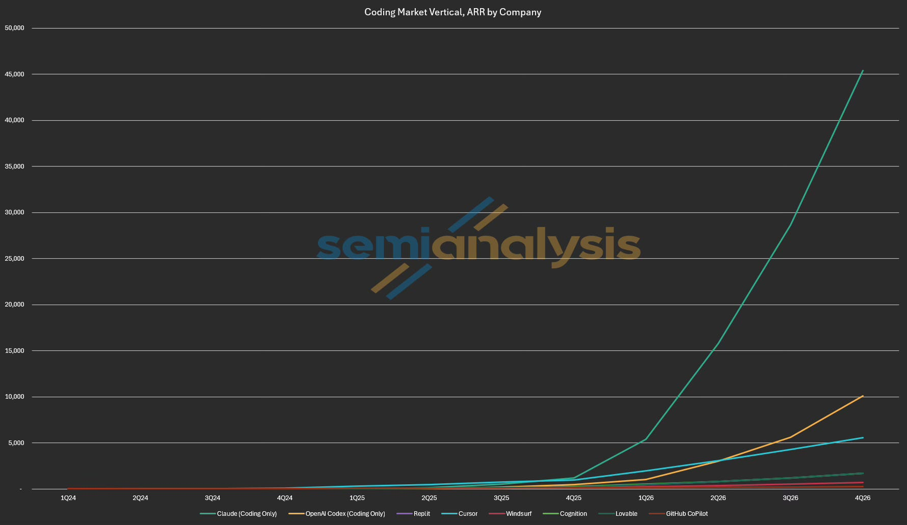
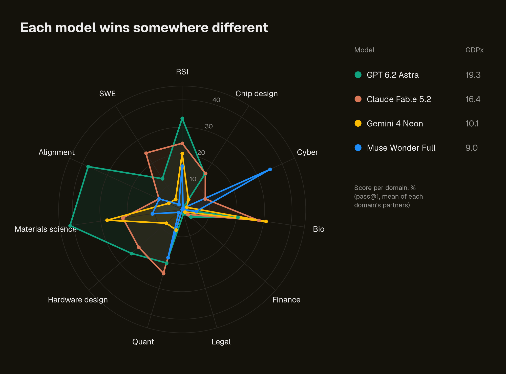
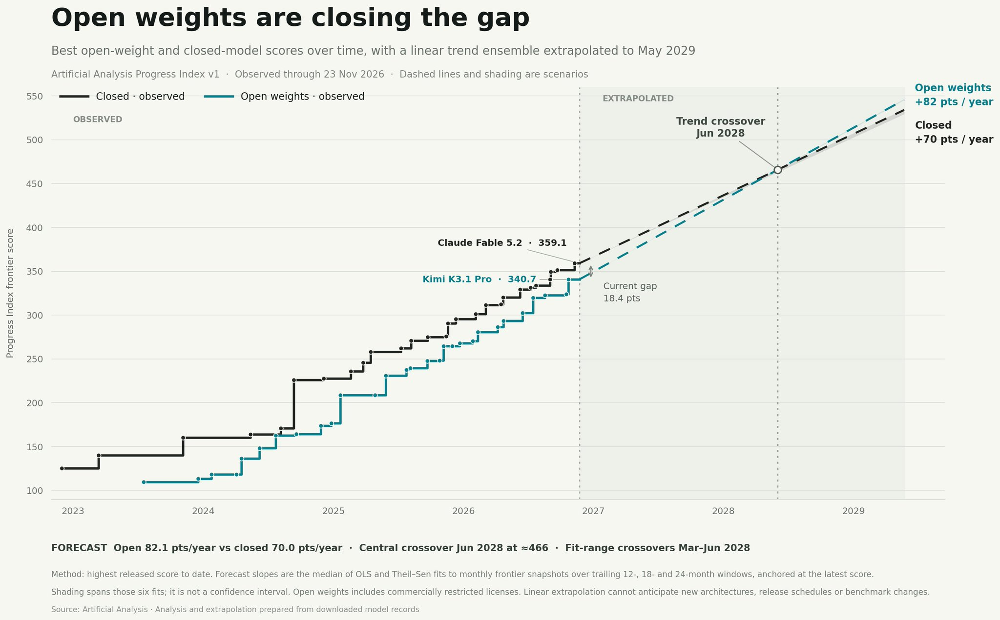
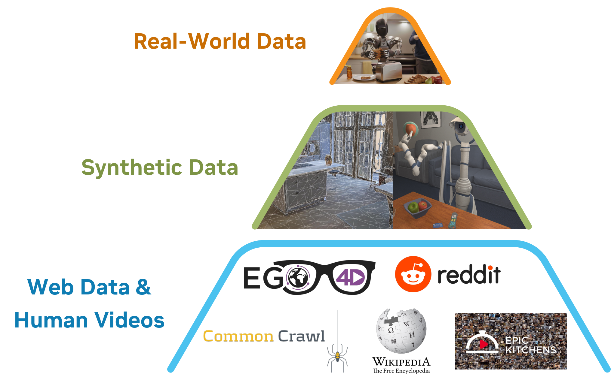

Since the space is moving so fast, I always find myself thinking about what the future will look like in the relatively short term, because the long term keeps getting harder to see. This year I want to try something new: write down some predictions for 2027, and next year look back at what I got wrong and, who knows, what I got right.

I started from five ideas and tried to break each one down:
1. Each frontier model will have its own taste.
2. Labs will fight distillation, and labs will pay for it.
3. Enterprises will post-train open models where it pays.
4. Humanoids will have a "GPT moment" embracing world models.
5. The whole AI application layer will become a neolab or a data vendor.

## 1. Each frontier model will have its own taste

Pretraining is converging. Every lab trains on more or less the same internet, filtered a bit differently, with architectures that improve in similar ways and get copied within months. If the base is the same, the difference has to come from somewhere else: **post-training**, and the data that goes into it. In 2026 that's also where the money came from. RL environments taught models to finish long coding tasks on their own, and coding agents became the fastest-growing business in AI.

*Source: [SemiAnalysis](https://newsletter.semianalysis.com/p/rl-systems-mind-the-gap-matching).*

That chart is why every lab will spend more on post-training data in 2027, and coding was just the first domain, the one where checking the answer is easier. But they won't all buy the same data, because the data market broke apart. When Meta bought into Scale AI, the other labs walked away from their biggest supplier and spread their budgets across dozens of smaller vendors, each one with its own experts, tasks and environments. For a lab, a fragmented market is safer, and it gives it data nobody else has. Different data in, different model out.

*Source: [SemiAnalysis GDPx](https://gdpx.semianalysis.com).*

You can already see it. Every frontier model wins somewhere different, and if you look at where each lab improved between its last two releases, it looks like each lab bought different data. In 2027 I expect this to grow: still general models, but with slightly different tastes, one more skilled in cyber, one in bio, one in finance, following the priorities each lab sets for itself. And which model is "best" will be decided less by puzzles and more by benchmarks like [GDPx](https://gdpx.semianalysis.com/), which score models on [real jobs](https://karpathy.ai/jobs/) done end to end.

## 2. Labs will fight distillation, and labs will pay for it

If post-training data is the moat, distillation is the cheapest way to steal it, and it works. 2026 is the year labs started treating it as theft. Anthropic went public with millions of extraction attempts from Chinese labs, competitors lost API access overnight, and reasoning traces got hidden.

The bill lands on us users. Security researchers get rerouted to older models, coding requests get flagged by cyber classifiers, and now [even normal AI research on Claude seems to get nerfed](https://x.com/skirano/status/2125371115979641188). Distillation is hard to detect, and in the name of "safety" everything is justified... In 2027 I expect more refusals, more "use Opus 4.8" messages and a lot of angry people doing honest work on AI and security.

You will feel it more and more: **the models are not aligned with you, they are aligned with their labs.**

## 3. Enterprises will post-train open models where it pays

Every enterprise AI budget grew faster than planned in 2026, and most of it went to two companies. Paying frontier prices on every call [makes less and less sense](https://www.forbes.com/sites/janakirammsv/2026/05/17/uber-burns-its-2026-ai-budget-in-four-months-on-claude-code/). A post-trained open model is cheaper to run, lives on your own infrastructure, and on a narrow job it can beat the frontier, as Harvey showed. Training got cheaper too: the same RL run costs a fraction on Tinker or Fireworks of what it did on OpenAI, which is even [closing its self-serve fine-tuning](https://developers.openai.com/api/docs/deprecations) in December.

*Source: [Artificial Analysis](https://artificialanalysis.ai) data.*

So the money will move; the open question is how fast. So far enterprises moved their cheap calls to open models, not their budgets, and almost nobody post-trains in-house. The hard part is not the training. It's turning years of legacy processes, permissions and messy data into environments and graders a model can learn from. That's why OpenAI, Mistral and even the data vendors are hiring [forward-deployed engineers](https://www.wsj.com/cio-journal/demand-for-forward-deployed-engineers-is-leading-to-1-5-million-paychecks-c1cd713a).

I don't think 2027 is the year everyone pivots. I think it's the year someone proves it works: a bank, an insurer or a pharma company running a post-trained open model on a core workflow, in production, cheaper and better than the API it replaced. Once one does it, the others will follow. And the winners won't be the model providers, but whoever can sit inside a company and build its environments on site, when the company can't do it on its own.

## 4. Humanoids will have a "GPT moment" embracing world models

Language models had the internet. Robots have nothing like it: every bit of robot data is collected by hand, on one body, in one lab, and the field still hasn't agreed on what that data should look like. Teleop, video of humans, simulation, or a mix? That is the real blocker, more than the hardware.

World models won't replace teleop or human video: robots still need real data to learn how the world feels. What world models add is variety. Take one real task and turn it into thousands: a different kitchen, different light, a heavier cup, a cup that slips. That's what RL environments did for language models, and it's exactly the part real data can't cover. World Labs is building its [whole robotics bet](https://www.worldlabs.ai/blog/real-to-sim-to-real) on this idea, and NVIDIA already trains its robots this way.

*Source: [NVIDIA GR00T N1](https://arxiv.org/html/2503.14734v2).*

Once the field settles on the modality, the bottleneck becomes compute, and compute is the one thing this industry knows how to scale. I expect that moment in the second half of 2027: **a frontier robotics lab will show that world-model data, on top of real data, is what makes its robots work in places they've never seen.** I don't expect any real deployments at scale in 2027.

## 5. The whole AI application layer will become a neolab or a data vendor

Two years ago the application layer was mostly crowded with apps that wrapped the top models, plus some agents, to serve different parts of the economy. Cursor, Harvey and hundreds of others put a product and a prompt around a frontier model, and whoever got there first and iterated faster took the podium. In 2026 the biggest ones turned into neolabs. Harvey [post-trained](https://x.com/gabepereyra/status/2090453918547685537) an open model on its own legal environments and doubled its pass rate on its own benchmark. Cursor (now owned by SpaceX) trains its own models too.

They showed everyone else the way. Once users do real work inside your product, you own the two things labs pay the most for: workflow and feedback. Training a model of your own on that is the obvious next step, and every year more app companies ship one, almost always on open weights (finally). Most still use it for a slice of the product and keep a frontier API for the hard part, so this is the beginning, not the end. By the end of 2027 **I expect every big AI SaaS company to have its own post-trained model.**

The ones that can't afford to train will sell what they have. Today the companies selling data to labs come from hiring and expert marketplaces: Mercor, Handshake and micro1 are among the fastest-growing. But as labs specialize by domain, they will need data no generalist marketplace has. A vertical app sits on exactly that. In 2027 I expect the first app companies to package their workflows as RL environments and sell them to labs, and the generalist vendors to split into vertical specialists.
